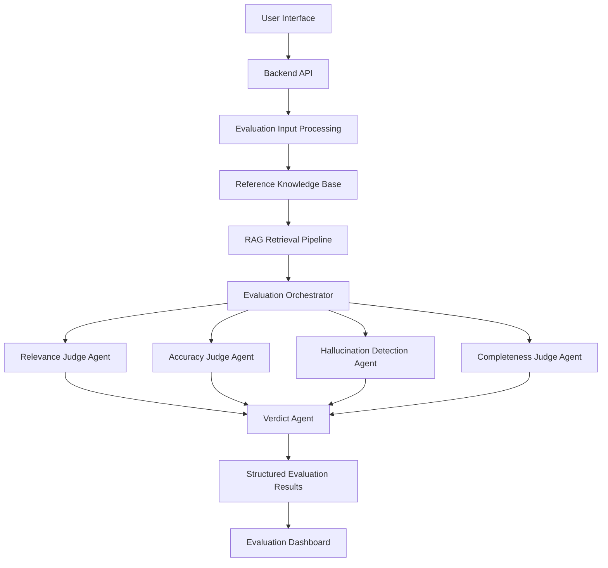

# VerityAI 🛡️

### Multi-Agent AI Response Evaluation & Hallucination Detection Platform

**Making AI responses more trustworthy, one evaluation at a time.**

VerityAI is an AI-powered response evaluation platform designed to assess the reliability, factual accuracy, relevance, and completeness of responses generated by Large Language Models (LLMs).

The platform uses a multi-agent evaluation architecture combined with Retrieval-Augmented Generation (RAG) to identify hallucinations, verify factual claims against reference knowledge, and generate structured evaluation reports.

> **Project Status:** Milestone 1 — Foundation & Evaluation Understanding (In Progress)

---

## 🎯 Project Objectives

- Evaluate AI-generated responses across multiple quality dimensions.
- Detect factual inaccuracies and hallucinated information.
- Verify generated claims using reference documents and benchmark datasets.
- Implement a multi-agent evaluation architecture.
- Build a RAG-powered reference knowledge base.
- Generate structured scores, explanations, and final verdicts.

## 🧠 Core Evaluation Dimensions

| Dimension     | Description                                                     |
| ------------- | --------------------------------------------------------------- |
| Relevance     | Measures how well the response addresses the question.          |
| Accuracy      | Evaluates the factual correctness of generated information.     |
| Hallucination | Identifies fabricated, unsupported, or contradicted claims.     |
| Completeness  | Measures whether the response covers the important information. |

## 🏗️ Proposed System Architecture



### Multi-Agent Architecture

| Agent                         | Responsibility                                         |
| ----------------------------- | ------------------------------------------------------ |
| Evaluation Orchestrator       | Coordinates the evaluation workflow and agents.        |
| Relevance Judge Agent         | Evaluates the relevance of the response.               |
| Accuracy Judge Agent          | Verifies factual correctness using reference evidence. |
| Hallucination Detection Agent | Identifies unsupported and fabricated claims.          |
| Completeness Judge Agent      | Evaluates missing or incomplete information.           |
| Verdict Agent                 | Combines scores and produces the final evaluation.     |

## ⚙️ Proposed Technology Stack

| Component             | Technology                        |
| --------------------- | --------------------------------- |
| Frontend              | React.js, Vite                    |
| Backend               | Python, FastAPI                   |
| AI / NLP              | Python, Hugging Face Transformers |
| Embeddings            | Sentence Transformers             |
| Vector Database       | ChromaDB                          |
| Dataset Processing    | Hugging Face Datasets             |
| Evaluation Frameworks | RAGAS, TruLens                    |
| Input Storage         | SQLite                            |
| Version Control       | Git, GitHub                       |

## 📚 Reference Knowledge Base

The initial knowledge base will use public question-answering benchmarks:

- **TruthfulQA:** A benchmark designed to evaluate whether language models generate truthful answers rather than common misconceptions.
- **SQuAD:** A reading comprehension dataset containing questions, answers, and supporting passages.

The knowledge base will include:

1. Dataset ingestion and preprocessing.
2. Text cleaning and standardization.
3. Document chunking.
4. Embedding generation.
5. Vector database indexing.
6. Semantic retrieval of relevant reference evidence.

## 🚀 Development Roadmap

### Milestone 1 — Foundation & Evaluation Understanding

- [x] Research LLM evaluation techniques.
- [x] Study hallucination detection and RAG architecture.
- [x] Explore RAGAS and TruLens.
- [x] Design system architecture and agent responsibilities.
- [x] Define evaluation dimensions and scoring methodology.
- [x] Develop the evaluation input module (FastAPI backend + React frontend).
- [x] Ingest TruthfulQA and SQuAD datasets.
- [x] Implement chunking, embeddings, and vector indexing.
- [x] Test semantic retrieval.

### Milestone 2 — Evaluation Judge Agents & Validation

- [x] **M2.1 — Relevance Judge Agent**: Scoring scale (0–10), structured reasoning, classification bands, Evaluation Orchestrator integration, and benchmark validation.
- [ ] **M2.2 — Accuracy Judge Agent**: Factuality verification against reference answers & RAG knowledge base.
- [ ] **M2.3 — Hallucination Detection Agent**: Atomic claim extraction and unsupported claim flagging.
- [ ] **M2.4 — Agent Evaluation & Consistency Validation**: Benchmark test suite calibration.

### Current Implementation Status

| Component | Status | Details |
|---|---|---|
| **Evaluation Input Module (Backend)** | ✅ Implemented | FastAPI endpoints for `POST /evaluations/`, `GET /evaluations/{id}`, `GET /evaluations/`, and `/health` with Pydantic validation and SQLite persistence via SQLAlchemy. |
| **Evaluation Input UI (Frontend)** | ✅ Implemented | React + Vite application with modern black-and-white aesthetic, collapsible icon sidebar, New Evaluation form, client-side validation, loading/error states, and Evaluation History viewer. |
| **Reference Knowledge Base & RAG** | ✅ Implemented (M1.4) | Chunking pipeline (500 tokens, 75 overlap), embedding service (`all-MiniLM-L6-v2`, 384-d normalized), persistent ChromaDB vector store, TruthfulQA + SQuAD ingestion pipeline, semantic retrieval service with similarity scoring and provenance packaging, and REST API endpoints (`/api/v1/retrieval/query`, `/api/v1/retrieval/status`). |
| **Relevance Judge Agent & Orchestrator** | ✅ Implemented (M2.1) | Relevance Judge Agent evaluating directness and intent on a 0–10 scale (`fully_relevant`, `mostly_relevant`, `partially_relevant`, `off_topic`, `unrelated`), pluggable LLM/deterministic fallback engine, and Evaluation Orchestrator (`POST /api/v1/judge/relevance`, `POST /api/v1/judge/submissions/{id}/evaluate`). |
| **Automated Test Suite** | ✅ Implemented | 48 unit and integration tests covering submission CRUD, input validation, chunking, embeddings, vector indexing, semantic retrieval, and judge evaluation using pytest. |
| **Subsequent Judge Agents** | ⏳ Planned (M2.2–M2.4) | Accuracy Judge Agent, Hallucination Detection Agent, and Consistency Validation. |

## 📁 Project Structure

```text
Verity/
│
├── backend/
│   ├── app/
│   │   ├── agents/
│   │   │   ├── llm_client.py           # Unified LLM provider client (OpenAI, Gemini, Local)
│   │   │   └── relevance_judge.py      # Relevance Judge Agent (0-10 calibrated scale)
│   │   ├── api/
│   │   │   └── routes/
│   │   │       ├── evaluation.py       # API endpoints (/evaluations/, /health)
│   │   │       ├── judge.py            # Judge evaluation endpoints (/api/v1/judge/)
│   │   │       └── retrieval.py        # Semantic retrieval API endpoints (/api/v1/retrieval/)
│   │   ├── core/
│   │   │   ├── config.py               # Settings (paths, DB URLs, model configs)
│   │   │   └── database.py             # SQLAlchemy engine, session maker, get_db dependency
│   │   ├── models/
│   │   │   └── evaluation.py           # EvaluationSubmission SQLAlchemy ORM model
│   │   ├── rag/
│   │   │   ├── chunker.py              # Text chunker (500 tokens, 75 overlap)
│   │   │   ├── embedder.py             # EmbeddingService (all-MiniLM-L6-v2, 384-d normalized)
│   │   │   ├── ingestion.py            # Benchmark ingestion (TruthfulQA + SQuAD)
│   │   │   ├── retriever.py            # SemanticRetriever with scoring & provenance
│   │   │   └── vector_store.py         # ChromaVectorStore wrapper with persistence
│   │   ├── schemas/
│   │   │   ├── evaluation.py           # Pydantic request & response schemas for submissions
│   │   │   ├── judge.py                # Pydantic schemas for judge inputs, outputs & status
│   │   │   └── retrieval.py            # Pydantic request & response schemas for retrieval
│   │   ├── services/
│   │   │   ├── evaluation_service.py   # Database query and persistence business logic
│   │   │   └── orchestrator.py         # Evaluation Orchestrator (coordinates RAG & agents)
│   │   └── main.py                     # FastAPI app creation, CORS middleware, lifespan
│   ├── scripts/
│   │   └── ingest_knowledge_base.py    # CLI script to ingest benchmark datasets into ChromaDB
│   ├── tests/
│   │   ├── test_evaluation.py          # 23 pytest tests for submission CRUD & validation
│   │   ├── test_rag.py                 # 12 pytest tests for chunking, embeddings, ChromaDB, & retrieval
│   │   └── test_relevance_judge.py     # 13 pytest tests for relevance scoring, LLM judge & orchestration
│   ├── requirements.txt                # Python backend dependencies
│   └── .env.example                    # Example backend environment configuration
│
├── frontend/
│   ├── src/
│   │   ├── api/
│   │   │   └── evaluationApi.ts        # Axios-based API client for backend endpoints
│   │   ├── components/
│   │   │   ├── icons.tsx               # Minimalist bespoke SVG icons
│   │   │   ├── Layout.tsx              # Main application shell with collapsible sidebar
│   │   │   ├── Sidebar.tsx             # Collapsible sidebar with Verity branding
│   │   │   └── StatusBadge.tsx         # Visual status pill (pending, running, etc.)
│   │   ├── pages/
│   │   │   ├── NewEvaluationPage.tsx   # Evaluation submission form with validation
│   │   │   └── EvaluationHistoryPage.tsx # Submissions list with side-by-side details
│   │   ├── types/
│   │   │   └── evaluation.ts           # TypeScript data interfaces
│   │   ├── App.tsx                     # React Router configuration
│   │   ├── main.tsx                    # Entry point
│   │   └── index.css                   # Global clean white/black theme design tokens
│   ├── package.json                    # React, Vite, Axios, React Router dependencies
│   ├── .env.example                    # Frontend environment template (VITE_API_BASE_URL)
│   └── vite.config.ts                  # Vite configuration
│
├── docs/                               # Research & architecture documentation
│   ├── architecture/
│   ├── datasets/
│   └── research/
│
├── README.md
└── .gitignore
```

## 💻 Getting Started

### Prerequisites

- Python 3.11
- Node.js (v18+) and npm
- Git

### Backend Setup & Execution

1. Navigate to the backend directory and activate the virtual environment:
   ```powershell
   cd backend
   .\venv\Scripts\Activate.ps1
   ```
2. Install dependencies:
   ```powershell
   pip install -r requirements.txt
   ```
3. Start the FastAPI development server:
   ```powershell
   uvicorn app.main:app --reload --port 8000
   ```
4. Access backend services:
   - **Interactive API Documentation (Swagger UI):** [http://localhost:8000/docs](http://localhost:8000/docs)
   - **Alternative API Documentation (ReDoc):** [http://localhost:8000/redoc](http://localhost:8000/redoc)
   - **Health Probe:** [http://localhost:8000/health](http://localhost:8000/health)

5. Ingest reference benchmark datasets into ChromaDB:
   ```powershell
   # Ingest TruthfulQA (validation split) and SQuAD v1.1
   python scripts/ingest_knowledge_base.py --dataset all --limit 500

   # Or ingest full TruthfulQA benchmark
   python scripts/ingest_knowledge_base.py --dataset truthfulqa
   ```

6. Run automated tests:
   ```powershell
   pytest tests -v
   ```

### Frontend Setup & Execution

1. Navigate to the frontend directory:
   ```powershell
   cd frontend
   ```
2. Install dependencies:
   ```powershell
   npm install
   ```
3. Copy environment configuration:
   ```powershell
   cp .env.example .env.local
   ```
4. Start the Vite development server:
   ```powershell
   npm run dev
   ```
5. Open your browser at [http://localhost:5173](http://localhost:5173).

## 🔬 Research References

- [RAGAS Documentation](https://docs.ragas.io/)
- [TruLens Documentation](https://www.trulens.org/)
- [Hugging Face Datasets](https://huggingface.co/docs/datasets)
- [Sentence Transformers](https://sbert.net/)
- [ChromaDB Documentation](https://docs.trychroma.com/)
- [TruthfulQA Dataset](https://huggingface.co/datasets/truthfulqa/truthful_qa)
- [SQuAD Dataset](https://huggingface.co/datasets/rajpurkar/squad)

## 📌 Current Status

VerityAI is currently in its foundation stage. Research, architecture design, input module development, and reference knowledge base implementation are the initial development priorities.

---

**VerityAI — Evaluating AI. Verifying Truth. Building Trust.**
