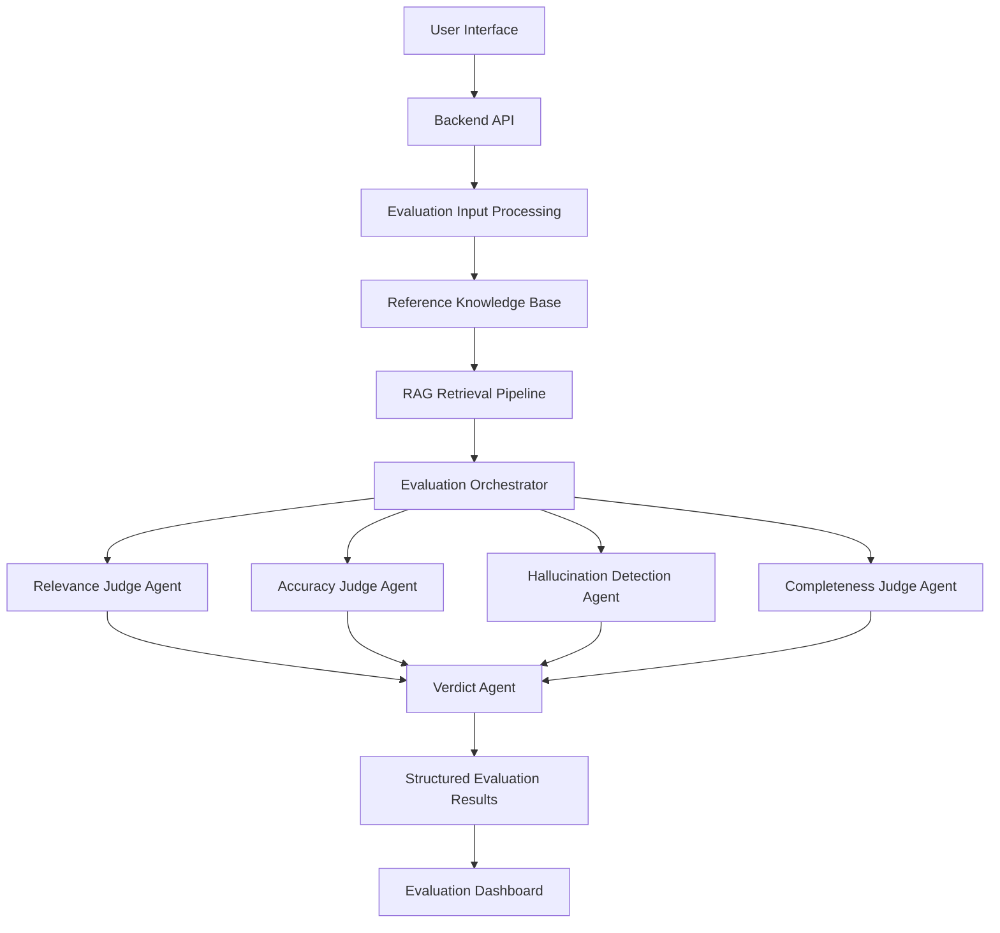

# VerityAI 🛡️

### Multi-Agent AI Response Evaluation & Hallucination Detection Platform

**Making AI responses more trustworthy, one evaluation at a time.**

VerityAI is an AI-powered response evaluation platform designed to assess the reliability, factual accuracy, relevance, and completeness of responses generated by Large Language Models (LLMs).

The platform uses a multi-agent evaluation architecture combined with Retrieval-Augmented Generation (RAG) to identify hallucinations, verify factual claims against reference knowledge, and generate structured evaluation reports.

> **Project Status:** Milestone 1 — Foundation & Evaluation Understanding (In Progress)

---

## 🎯 Project Objectives

- Evaluate AI-generated responses across multiple quality dimensions.
- Detect factual inaccuracies and hallucinated information.
- Verify generated claims using reference documents and benchmark datasets.
- Implement a multi-agent evaluation architecture.
- Build a RAG-powered reference knowledge base.
- Generate structured scores, explanations, and final verdicts.

## 🧠 Core Evaluation Dimensions

| Dimension     | Description                                                     |
| ------------- | --------------------------------------------------------------- |
| Relevance     | Measures how well the response addresses the question.          |
| Accuracy      | Evaluates the factual correctness of generated information.     |
| Hallucination | Identifies fabricated, unsupported, or contradicted claims.     |
| Completeness  | Measures whether the response covers the important information. |

## 🏗️ Proposed System Architecture



### Multi-Agent Architecture

| Agent                         | Responsibility                                         |
| ----------------------------- | ------------------------------------------------------ |
| Evaluation Orchestrator       | Coordinates the evaluation workflow and agents.        |
| Relevance Judge Agent         | Evaluates the relevance of the response.               |
| Accuracy Judge Agent          | Verifies factual correctness using reference evidence. |
| Hallucination Detection Agent | Identifies unsupported and fabricated claims.          |
| Completeness Judge Agent      | Evaluates missing or incomplete information.           |
| Verdict Agent                 | Combines scores and produces the final evaluation.     |

## ⚙️ Proposed Technology Stack

| Component             | Technology                        |
| --------------------- | --------------------------------- |
| Frontend              | React.js, Vite                    |
| Backend               | Python, FastAPI                   |
| AI / NLP              | Python, Hugging Face Transformers |
| Embeddings            | Sentence Transformers             |
| Vector Database       | ChromaDB                          |
| Dataset Processing    | Hugging Face Datasets             |
| Evaluation Frameworks | RAGAS, TruLens                    |
| Input Storage         | SQLite                            |
| Version Control       | Git, GitHub                       |

## 📚 Reference Knowledge Base

The initial knowledge base will use public question-answering benchmarks:

- **TruthfulQA:** A benchmark designed to evaluate whether language models generate truthful answers rather than common misconceptions.
- **SQuAD:** A reading comprehension dataset containing questions, answers, and supporting passages.

The knowledge base will include:

1. Dataset ingestion and preprocessing.
2. Text cleaning and standardization.
3. Document chunking.
4. Embedding generation.
5. Vector database indexing.
6. Semantic retrieval of relevant reference evidence.

## 🚀 Development Roadmap

### Milestone 1 — Foundation & Evaluation Understanding

- [x] Research LLM evaluation techniques.
- [x] Study hallucination detection and RAG architecture.
- [x] Explore RAGAS and TruLens.
- [ ] Design system architecture and agent responsibilities.
- [ ] Define evaluation dimensions and scoring methodology.
- [ ] Develop the evaluation input module.
- [ ] Ingest TruthfulQA and SQuAD datasets.
- [ ] Implement chunking, embeddings, and vector indexing.
- [ ] Test semantic retrieval.

### Future Milestones

Detailed implementation scope and features will be added as subsequent milestone requirements are finalized.

## 📁 Project Structure

```text
verity-ai/
│
├── backend/
│   ├── app/
│   ├── data/
│   ├── vector_db/
│   ├── tests/
│   └── requirements.txt
│
├── frontend/
│   └── src/
│
├── docs/
│
├── README.md
└── .gitignore
```

The project structure will evolve as development progresses.

## 💻 Getting Started

### Prerequisites

- Python 3.11
- Node.js and npm
- Git
- VS Code (recommended)

### Backend Setup

```bash
cd backend

# Windows PowerShell
py -3.11 -m venv venv

.\venv\Scripts\Activate.ps1

python -m pip install --upgrade pip
```

Backend dependencies and execution instructions will be updated as implementation progresses.

### Frontend Setup

Frontend dependencies and execution instructions will be added when the React application is initialized.

## 🔬 Research References

- [RAGAS Documentation](https://docs.ragas.io/)
- [TruLens Documentation](https://www.trulens.org/)
- [Hugging Face Datasets](https://huggingface.co/docs/datasets)
- [Sentence Transformers](https://sbert.net/)
- [ChromaDB Documentation](https://docs.trychroma.com/)
- [TruthfulQA Dataset](https://huggingface.co/datasets/truthfulqa/truthful_qa)
- [SQuAD Dataset](https://huggingface.co/datasets/rajpurkar/squad)

## 📌 Current Status

VerityAI is currently in its foundation stage. Research, architecture design, input module development, and reference knowledge base implementation are the initial development priorities.

---

**VerityAI — Evaluating AI. Verifying Truth. Building Trust.**
