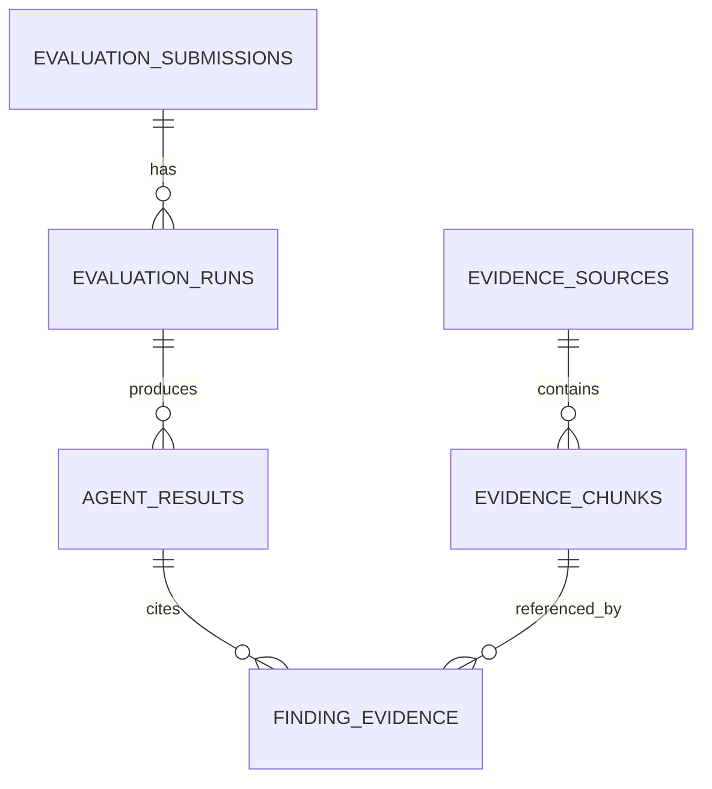

# Database Schema Design

## 1. Purpose

VerityAI needs to store user submissions and evaluation results. The relational database stores application records. The vector database stores searchable reference chunks and embeddings; these are separate responsibilities.

## 2. Initial relational model (Implemented)

The `evaluation_submissions` table is implemented in `backend/app/models/evaluation.py` using SQLAlchemy ORM and SQLite.

| Field | Type | Nullable | Constraints / Details | Purpose |
|---|---|---:|---|---|
| `id` | Integer | No | Primary key, autoincrement, indexed | Unique identifier |
| `question` | Text | No | Non-empty, 10–5000 chars | User's question or prompt |
| `ai_response` | Text | No | Non-empty, 10–20000 chars | AI-generated candidate answer |
| `reference_answer` | Text | Yes | Max 10000 chars (empty → NULL) | Optional ground-truth answer |
| `source_document` | Text | Yes | Max 50000 chars (empty → NULL) | Optional source reference material |
| `status` | String(20) | No | Default: `'pending'` | Lifecycle state (see allowed values) |
| `created_at` | DateTime | No | UTC timestamp | Record creation timestamp |

The initial SQLAlchemy model is intentionally small. It supports the input module but does not yet represent completed agent evaluations.

### Allowed status values for `evaluation_submissions`

| Value | Meaning |
|---|---|
| `pending` | Submission stored; evaluation not yet started |
| `running` | Evaluation pipeline is active |
| `completed` | Evaluation finished and report stored |
| `failed` | Evaluation pipeline encountered a fatal error |
| `partial` | One or more agents failed; report is incomplete |

Implement as a Python `Enum` or string constant to prevent arbitrary values being written.

## 3. Proposed future tables

### evaluation_runs
One row per attempt to evaluate a submission.

Suggested fields:
- `id` — primary key
- `submission_id` — foreign key to evaluation_submissions
- `status` — pending, running, completed, failed, partial
- `overall_score` — nullable numeric score
- `verdict` — nullable verdict label
- `started_at`, `completed_at`
- `model_version`, `prompt_version`, `rubric_version`

### agent_results
One row per agent result in an evaluation run.

Suggested fields:
- `id` — primary key
- `evaluation_run_id` — foreign key
- `agent_name`
- `score` — nullable numeric score
- `summary`
- `structured_result` — JSON
- `status`
- `created_at`

### evidence_sources
Metadata for source documents or dataset records.

Suggested fields:
- `id` — primary key
- `source_type` — dataset, user_text, uploaded_document, etc.
- `source_name`
- `external_source_id`
- `title`
- `metadata` — JSON
- `created_at`

### evidence_chunks
Metadata for chunks indexed in ChromaDB.

Suggested fields:
- `id` — stable chunk identifier
- `source_id` — foreign key to evidence_sources
- `chunk_index`
- `chunk_text` or a retrievable text reference
- `vector_store_id`
- `metadata` — JSON

### finding_evidence
Associates a claim-level finding with one or more evidence chunks.

Suggested fields:
- `id` — primary key
- `agent_result_id` — foreign key
- `finding_index`
- `evidence_chunk_id` — foreign key or stable external ID
- `relationship` — supports, contradicts, or context

## 4. Vector database metadata

Each ChromaDB record should include enough metadata to trace it to its source. Suggested metadata:
- `dataset_name`
- `dataset_split`
- `source_record_id`
- `chunk_index`
- `title` or article context, when available
- `source_url`, when available
- `content_type`

Do not store secrets or unnecessary personal data in metadata.

## 5. Relationship overview

The future tables are a design proposal, not all implemented in the current backend.

## 6. Database choice

SQLite is suitable for early local development and a single-user prototype. PostgreSQL can be considered when concurrent usage, deployment, or richer relational requirements justify migration. ChromaDB remains the vector index in the initial design.

## 7. Data lifecycle

Define retention, deletion, and access rules before collecting real user submissions. Avoid storing API keys, passwords, or other secrets in database records.
