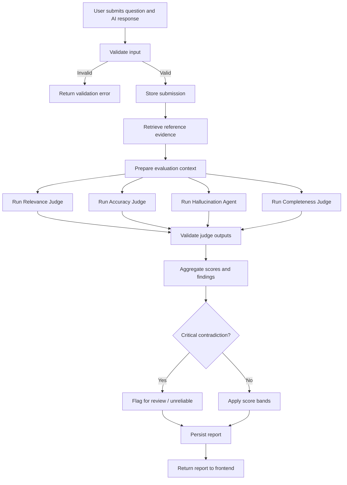

# Evaluation Orchestration Workflow

## 1. Workflow objective

This document describes the intended path from a user's submission to a VerityAI evaluation report.

## 2. Workflow diagram

## 3. Input contract

Required:
- `question`
- `ai_response`

Optional:
- `reference_answer`
- `source_document`

The first implementation accepts source text rather than an uploaded file. The backend should reject missing required fields and enforce sensible length limits.

## 4. Evidence preparation

- Combine user-provided source text with retrieved knowledge-base passages as separate evidence sources.
- Give each passage a stable ID and source metadata.
- Avoid losing the distinction between a supplied reference and a general dataset result.
- If no useful passages are found, set evidence status to insufficient rather than treating the answer as false.

## 5. Agent execution

The four judges can initially run sequentially for simpler debugging. They may run concurrently later if they are independent and resource limits allow it.

Each judge receives:
- Original question.
- Candidate AI response.
- Optional reference answer.
- Evidence passages and IDs.
- Its specific scoring rubric.

Each returns a validated structured result.

## 6. Aggregation

1. Confirm all required judge results are present or mark missing results.
2. Calculate the provisional weighted score.
3. Apply critical contradiction safeguards.
4. Generate the overall verdict.
5. Include dimension scores, findings, evidence references, limitations, and review flags.

## 7. Suggested verdict labels

- **Reliable:** Strong scores and no critical contradiction detected.
- **Mostly Reliable:** Generally supported, with minor issues or omissions.
- **Needs Review:** Material uncertainty, missing evidence, or conflicting judge results.
- **Unreliable:** Severe factual contradiction or high hallucination risk.

These labels are proposed and should be calibrated with a labelled evaluation set.

## 8. Persistence and traceability

For each evaluation run, retain (subject to privacy and retention policy):
- Submission ID.
- Run status and timestamps.
- Retrieved evidence IDs and source metadata.
- Agent scores and findings.
- Aggregated score and verdict.
- Model, prompt, and rubric versions.
- Errors or partial-execution details.

## 9. Implementation stages & progress

1. **Stage 1 (Completed — M1.3):** Complete and test the submission API (`POST /evaluations/`, `GET /evaluations/{id}`, `GET /evaluations/`, `/health`).
2. **Stage 2 (Completed — M1.3):** Build the frontend input form, history browser, and connect to the API with validation and error handling.
3. **Stage 3 (Completed — M1.4):** Ingest and clean the initial reference datasets (TruthfulQA validation split, SQuAD v1.1 validation split).
4. **Stage 4 (Completed — M1.4):** Implement chunking (~500 tokens, 75 overlap), embedding generation (`all-MiniLM-L6-v2`), and ChromaDB persistent vector indexing.
5. **Stage 5 (Completed — M1.4):** Build and test semantic retrieval service with similarity scoring, threshold filtering, and provenance packaging (`/api/v1/retrieval/query`).
6. **Stage 6 (Completed — M2.1):** Build the Relevance Judge Agent with calibrated 0–10 rubric, structured Pydantic input/output schemas, LLM/deterministic fallback engines, and Evaluation Orchestrator integration.
7. **Stage 7 (Completed — M2.2):** Implement the Accuracy Judge Agent (grounding against reference answers & RAG evidence passages, calibrated 0–10 scoring, claim identification, critical contradiction safeguards, and evidence citations).
8. **Stage 8 (Upcoming — M2.3):** Implement the Hallucination Detection Agent (atomic claim extraction & contradiction detection).
9. **Stage 9 (Upcoming — M2.4):** Benchmark validation, consistency testing, and scoring calibration across TruthfulQA and SQuAD.
