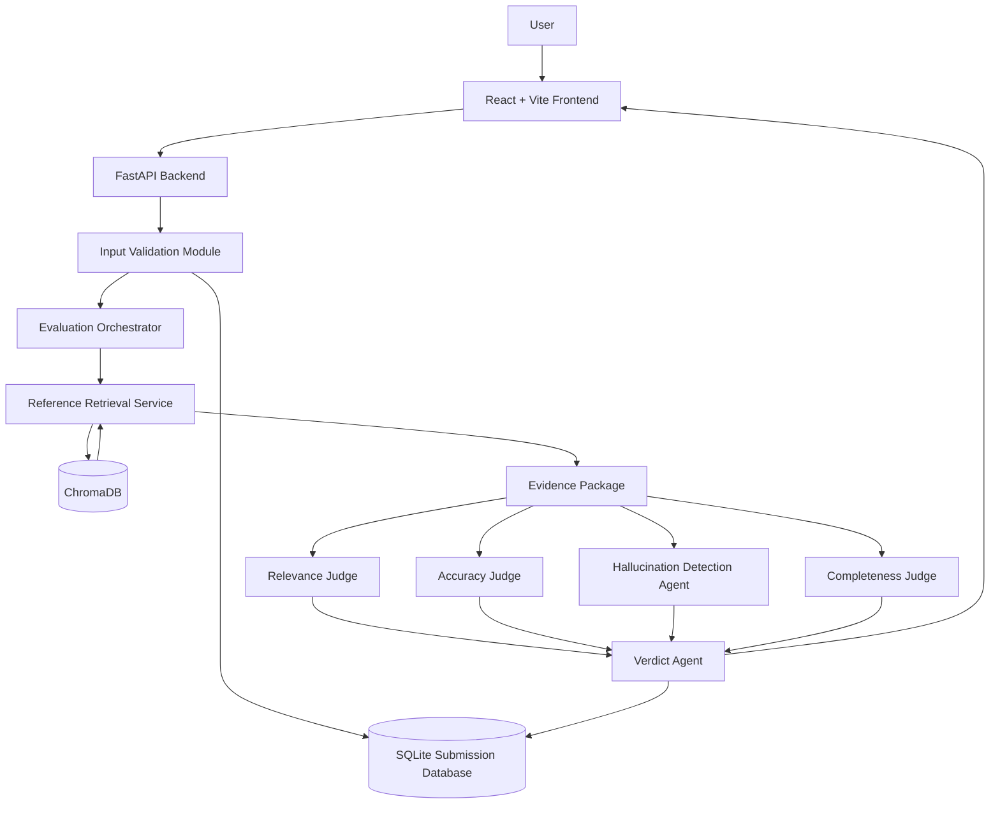

# VerityAI System Architecture

## 1. System overview

**VerityAI** is a multi-agent AI response evaluation and hallucination detection platform.

It accepts:
- A question or prompt.
- An AI-generated response.
- An optional reference answer.
- Optional source text.

It validates and stores the submission, retrieves supporting evidence, evaluates the response across multiple dimensions, and produces a structured report.

## 2. High-level architecture

## 3. Main components

### Frontend
React and Vite provide the submission form and evaluation-report interface. The first input interface accepts the question, AI response, optional reference answer, and optional source text.

### API layer
FastAPI exposes endpoints, validates request data using Pydantic schemas, and coordinates service calls.

### Submission database
SQLite stores evaluation submissions and, as the project grows, evaluation runs and results. ChromaDB is separate and stores searchable reference chunks and embeddings.

### Reference knowledge base
Hugging Face datasets are cleaned, chunked, embedded, and indexed in ChromaDB. Retrieval returns evidence passages with provenance.

### Orchestration and agents
The orchestrator controls the evaluation workflow. Specialized agents assess relevance, accuracy, hallucination risk, and completeness. The verdict component combines their results and explanations.

## 4. Proposed technology stack

| Layer | Technology |
|---|---|
| Frontend | React, Vite |
| Backend/API | Python 3.11, FastAPI |
| Request validation | Pydantic |
| Relational persistence | SQLAlchemy, SQLite initially |
| Dataset processing | Hugging Face Datasets |
| Embeddings | Sentence Transformers |
| Vector database | ChromaDB |
| Evaluation research/benchmarking | RAGAS, TruLens |
| Version control | Git, GitHub |

The stack is the initial project design and may be revised after implementation and testing.

## 5. Data flow

1. User submits an evaluation request.
2. API validates required and optional fields.
3. Submission is stored with a pending status.
4. Orchestrator prepares the evaluation context.
5. Retrieval service finds relevant reference passages.
6. Judge agents evaluate the response using the question, answer, references, and evidence.
7. Verdict component aggregates scores and critical findings.
8. The report is stored and returned to the frontend.

## 6. Design principles

- Keep agent responsibilities separate and testable.
- Preserve source provenance for every retrieved chunk.
- Represent insufficient evidence explicitly.
- Store model, prompt, and rubric versions for reproducibility.
- Validate all agent outputs against schemas.
- Keep the initial API and UI simple before adding file parsing or advanced retrieval.

## 7. Current implementation boundary & status

### Implemented in Milestone 1 (Evaluation Input Module)
- **Frontend Submission & History UI**: React + Vite application providing the evaluation submission form, input validation, loading states, and history browsing with detail views.
- **Backend API Layer**: FastAPI application exposing `POST /evaluations/`, `GET /evaluations/{id}`, `GET /evaluations/` (paginated), and `/health` with CORS support for local development.
- **Input Validation**: Pydantic v2 schemas validating required fields, trimming whitespace, enforcing character limits (10–5,000 for question, 10–20,000 for AI response, up to 10,000 for reference answer, up to 50,000 for source document), and coercing blank optional fields to `None`.
- **Relational Persistence**: SQLite database managed via SQLAlchemy ORM with the `evaluation_submissions` table storing question, AI response, optional reference answer, optional source text, status, and UTC timestamp.
- **Test Suite**: Automated pytest suite verifying all endpoints, status codes, database session handling, and validation rules against an isolated in-memory SQLite database.

### Planned for subsequent phases
- **Reference Knowledge Base (M1.4)**: Ingestion of TruthfulQA and SQuAD, chunking, embedding generation with Sentence Transformers, and ChromaDB vector indexing.
- **RAG Retrieval Pipeline (M1.4)**: Semantic similarity search for relevant reference passages.
- **Multi-Agent Evaluation Pipeline (M2)**: Evaluation Orchestrator, Judge Agents (Relevance, Accuracy, Hallucination, Completeness), and Verdict Agent.
- **Advanced Features**: PDF/file uploads, document parsing, batch evaluation, and background job queueing.

## 8. M1.1 findings summary

This section consolidates the technology choices, evaluation approach, and implementation strategy documented during M1.1 research.

### Technology choices

| Concern | Decision | Rationale |
|---|---|---|
| Backend | FastAPI + Python 3.11 | Async-ready, Pydantic integration, good ecosystem |
| Input validation | Pydantic v2 | Schema enforcement, structured error messages |
| Relational storage | SQLAlchemy + SQLite | Simple local dev; migration path to PostgreSQL later |
| Embeddings | `sentence-transformers/all-MiniLM-L6-v2` | Small, practical baseline; fast inference |
| Vector store | ChromaDB | Easy local setup, metadata filtering, Python-native |
| Dataset access | Hugging Face Datasets | Both TruthfulQA and SQuAD available via `load_dataset` |
| Evaluation references | RAGAS, TruLens | Study metrics and patterns; not used as black-box scores |
| Frontend | React + Vite | Fast dev server, component model fits submission form |

### Evaluation dimensions

Responses are evaluated across four dimensions: **Relevance**, **Accuracy**, **Hallucination risk**, and **Completeness**, each scored 0–10. The provisional weighted score formula is `S = 0.25R + 0.35A + 0.25(10 - H) + 0.15C`. See `agent-design.md` for the full rubric.

### Implementation strategy

1. Build and test the FastAPI submission endpoint with Pydantic validation and SQLite storage (M1.3).
2. Ingest, clean, chunk, and embed TruthfulQA and SQuAD; index in ChromaDB (M1.4).
3. Validate retrieval quality against sample questions.
4. Scaffold agent interfaces with mock structured outputs before integrating a live LLM judge.
5. Implement aggregation and verdict logic, then connect the React frontend.

## 9. Future architecture components

The following components are part of the full system design but are deferred beyond M1. They appear in the high-level component list and should be documented here so the architecture remains traceable.

| Component | Intended role |
|---|---|
| Knowledge Base Update Module | Adds or re-indexes new source documents or datasets without full re-ingestion |
| Batch Evaluation Module | Accepts a list of question/answer pairs and evaluates them in bulk |
| Evaluation Report Generation Module | Renders formatted evaluation reports (PDF, HTML) from stored results |
| Results & Evaluation Dashboard Interface | Displays evaluation history, scores, trends, and detailed findings |

These are not implemented in M1. Their interfaces and data contracts will be defined when the corresponding milestones are scoped.
