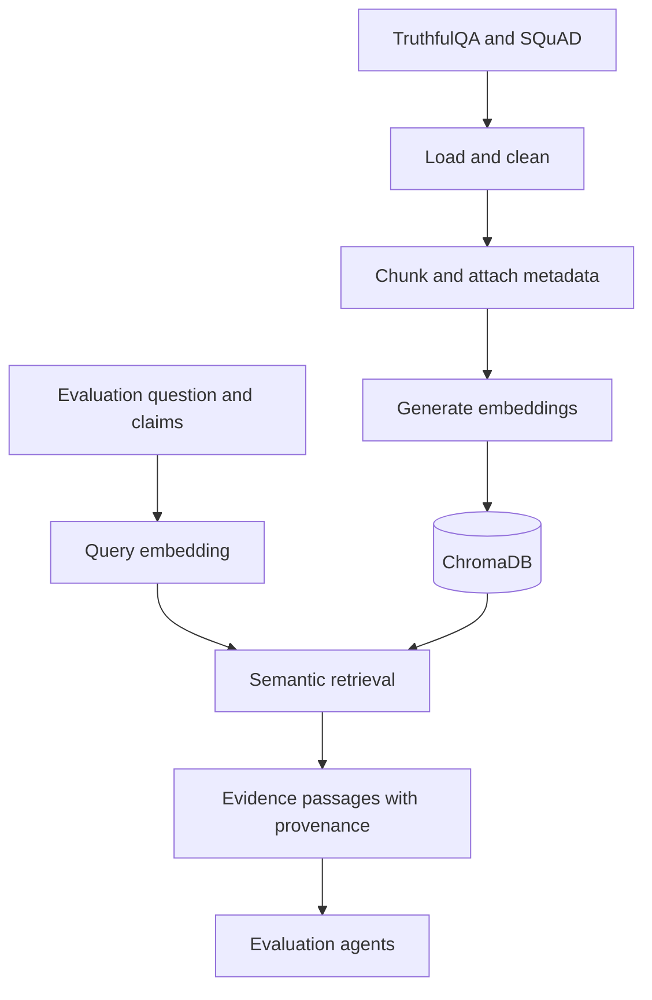

# Retrieval-Augmented Generation (RAG) Architecture

## 1. What is RAG?

Retrieval-Augmented Generation (RAG) combines information retrieval with a language model. Instead of relying only on information encoded in model parameters, the system retrieves relevant external passages and supplies them as context for a task.

For VerityAI, retrieval provides evidence that evaluation agents can use when checking factual claims.

RAG does not guarantee truth. The retrieved material may be wrong, outdated, incomplete, or irrelevant. The system must preserve source information and assess evidence quality.

## 2. Knowledge-base ingestion

The ingestion pipeline prepares source material for semantic retrieval:

1. **Collect:** Load approved datasets and user-provided text.
2. **Normalize:** Standardize text encoding and remove unusable records.
3. **Clean:** Remove empty content and clearly duplicated or malformed entries while preserving meaningful context.
4. **Chunk:** Split long passages into smaller overlapping segments.
5. **Attach metadata:** Store dataset, source ID, title/context, split, and other provenance.
6. **Embed:** Convert each chunk into a dense vector using an embedding model.
7. **Index:** Store vectors, text, and metadata in a vector database.
8. **Validate:** Run sample queries and inspect retrieval quality.

## 3. Query-time retrieval

1. Receive the evaluation question and, where useful, the candidate answer or extracted claims.
2. Create a query embedding using the same embedding model used for the corpus.
3. Search the vector store for the top-k similar chunks.
4. Optionally filter by dataset or source type.
5. Return passages with stable IDs, similarity/distance information, and provenance.
6. Pass the evidence to the relevant evaluation agents.

The initial design uses semantic similarity search. Hybrid search (keyword plus vector search), reranking, and metadata filters can be added after measuring baseline retrieval quality.

## 4. Initial technical choices

| Component | Initial choice | Reason |
|---|---|---|
| Embedding model | `sentence-transformers/all-MiniLM-L6-v2` | Small, practical baseline model |
| Vector store | ChromaDB | Simple local development and metadata support |
| Dataset loader | Hugging Face Datasets | Convenient dataset access |
| Initial chunk target | About 500 tokens | Starting point for experiments |
| Chunk overlap | About 75 tokens | Helps preserve boundary context |
| Retrieval count | Top 5 chunks | Initial value to evaluate |

These are baseline settings, not proven optimal values. Chunk size, overlap, and top-k should be tuned using a retrieval test set.

## 5. Chunking considerations

A chunk should contain enough context to support a claim but not so much unrelated text that retrieval becomes noisy.

Recommended practices:
- Prefer paragraph or sentence boundaries.
- Preserve document title and section context in metadata.
- Use overlap to reduce information loss at chunk boundaries.
- Avoid splitting question-answer pairs in a way that loses their relationship.
- Store original source IDs so retrieved chunks can be traced back.

For SQuAD, preserve the article context and question/answer relationship. For TruthfulQA, preserve the question, answer, category, and correctness metadata where available. Do not treat a short answer as if it were a full source passage.

## 6. Retrieval validation

Create a small set of test queries with expected relevant source IDs. Measure or inspect:
- **Recall@k:** Whether relevant evidence appears among the top k results.
- **Precision@k:** How many retrieved results are relevant.
- **MRR:** How highly the first relevant result is ranked.
- **Evidence usefulness:** Whether a human or evaluator can use the passage to assess the claim.

Inspect failed queries manually. A high embedding similarity does not guarantee that a passage entails a claim.

## 7. VerityAI RAG flow

## 8. Limitations and future improvements

- Add source trust and freshness metadata.
- Add hybrid retrieval and reranking if baseline retrieval is weak.
- Support PDF and web-document extraction after the plain-text workflow is stable.
- Add dataset versioning and reproducible ingestion.
- Detect conflicting sources rather than silently choosing one.
- Evaluate retrieval independently from the quality of the LLM judges.

## 9. References

- Sentence Transformers semantic search: https://sbert.net/examples/sentence_transformer/applications/semantic-search/README.html
- Chroma documentation: https://docs.trychroma.com/
- Hugging Face Datasets: https://huggingface.co/docs/datasets/
